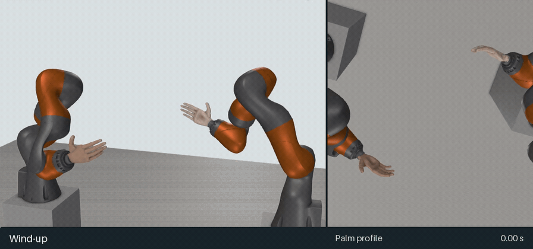

# Dap: Angle and Alignment Matching for Robotic Hands

6.4210 final project — Josh Nix, Oliver Wang, Samuel Zhou.

Two simulated iiwa arms face each other in Drake, in a layout randomized per
trial. The partner arm's hand approaches along a randomized, human-like path;
our arm sees it through a head-mounted depth camera (the pixel policy learns
from its frames; a noisy pose sensor stands in for perception in the `state`
modes and the `servo` baseline) and has to meet it palm to palm: palms parallel with fingers opposite. The task is purely kinematic:
rigid hands, no clasp, and the trial ends at the touch. Each scenario draws
its own partner speed (peak palm speed 0.15–0.9 m/s).

**Problem setup, every parameter and its source:** [docs/setup.md](docs/setup.md).
Perception pipeline (the `servo_depth` baseline): [docs/perception_pipeline.md](docs/perception_pipeline.md).
**Next (Phase 2, perception):** [docs/phase2_plan.md](docs/phase2_plan.md).

**Proposal (living draft):** https://claude.ai/artifact/QUBj973spHWSZKigTEf1Cz

## Watch the cupped-hand dap

Two KUKA iiwa arms start with their cupped right hands about 66 cm apart. The striking arm sweeps outward and up, rolls its wrist into a single palm tap, then follows a lower curve back. The receiving arm follows a shorter arc. All fingers and thumbs hold their shape. The fixed camera shows the full swing, and the profile view shows the palms at contact.



[Full-resolution video](docs/hand_dap.mp4) · [Motion, contact checks, and human reference](docs/hand_dap.md)

To render the gesture locally, run `make setup` and `make dap`. The video and GIF are written to `results/hand_dap/`.

## Earlier first-contact experiment

The earlier depth-to-joint-goal experiment compared a learned policy with a pose-based replanner. Its [report](docs/report.pdf), [paired records](docs/results/) and [success](docs/success.gif) and [collision](docs/collision.gif) clips are archived here. To rerun that experiment use its [original code, loss weights and commands](https://github.com/SeekingBeta314/dap-project/tree/5226d3c480e755f1137dd0895a1eeeb43a75299f). The current perception experiment compares a distilled policy with classical hand tracking on the same camera model.

## Layout

| Path | What | Status |
| --- | --- | --- |
| `models/dap_hand.sdf` | Rigid flat hand: palm + fixed fingers (`package://dap/...`) | done |
| `dap/scene.py` | Two iiwa7s on pedestals, partner pose from a `SceneLayout`; `Scene` helpers (posing, palms, distances, camera) | done |
| `dap/scenario.py` | Per-trial sampler: layout, meeting point, feasibility, partner motion, start configs; presets `fixed`/`nominal`/`wide` | done |
| `dap/feasibility.py` | Two-arm IK check that a palm-to-palm dap exists (+ reach-in-time check) | done |
| `dap/partner.py` | Min-jerk Bezier palm path at a sampled peak speed (overshoot, optional target switch), executed by the partner iiwa within its limits; noisy pose sensor | done |
| `dap/ik.py` | Single-arm IK helper | done |
| `dap/camera.py` | D435-like head camera (848x480, 58 deg vFOV, 30 fps) + frame-rate/latency buffer | done |
| `dap/depth_noise.py` | D435-style depth noise (disparity noise, jitter, fixed pattern, dropout, shadow, holes) | done |
| `dap/envs/` | Gymnasium env `dap/PalmMeet-v0`: `pixels` (own arm + depth frame stack), `privileged` (training only), `state`, `state+depth`; reward hook | done |
| `dap/reward.py` | Training reward: the evaluation loss at the episode's end, potential-based shaping, action-rate penalty | done |
| `dap/teacher.py` | PPO teacher on the privileged state, with per-worker rollout collection (`ParallelPPO`), a warm start and DAgger toward the servo expert (`ServoExpert`, `warm_start`, `dagger`), optional kickstarting, and a loader for scoring and DAgger labels | done; in training |
| `scripts/train_teacher.py` | Train the teacher on the bank (`--warm-start N` to start from the expert, `--dagger-rounds R`, `--kick-coef`); checkpoints scored on validation seeds | done |
| `scripts/check_teacher.py` | The teacher's bar check: a checkpoint, `servo_gt_cam` and the servo expert on validation seeds 100–299 (`teacher_bar`), analysed by `analyze.py` | done |
| `dap/bank.py` | Training scenario bank: sampled once from training seeds, rebuilt exactly in ~0.1 s | done |
| `dap/policy_eval.py` | Scores a learned policy on experiment seeds like any trial | done |
| `dap/estimator.py` | Constant-acceleration Kalman filter + palm-normal and finger-direction filters | done (first pass) |
| `dap/planner.py` | Controller contract (`ControllerModel`, `reset`/`step`) | done |
| `dap/baselines.py` | Baselines: hold, blind (fixed pose), diff-IK servo on the stand-in sensor, on depth perception, on ground truth or on ground truth at camera timing; oracle reference | done |
| `dap/perception.py` | Label-free partner-palm perception from head-camera depth (for `servo_depth`) | done |
| `dap/scoring.py` | The one definition of contact, collision, success, scores and the (vectorized) loss | done |
| `dap/metrics.py` | Per-trial result record (harness measurements only) | done |
| `dap/stats.py` | Wilson intervals, exact McNemar, paired bootstrap, Holm | done |
| `dap/experiment.py` | Conditions (controller x sensor noise), seed splits (train / val / eval), named configs (`smoke`, `first_look`, `first_look_wide`) | done |
| `dap/trial.py` | Causal kinematic trial loop: arm limits enforced, ground truth logged, scored afterwards | done |
| `scripts/show_scene.py` | View a sampled scenario in Meshcat, animate it, or save head-camera depth | done |
| `scripts/run_experiment.py` | Run a config, append to `results/<name>/trials.jsonl` | done |
| `scripts/analyze.py` | Paired analysis: rates with Wilson CIs, McNemar, paired bootstrap of the loss, success vs. partner speed | done |
| `tests/` | Scene, camera, depth noise, feasibility, scenario, scoring, stats, estimator, trial harness, seed splits, baselines, perception, scenario bank, env (gymnasium `check_env`), policy scoring, analysis, and a regression lock on trial and env behavior (`tests/data/regression_golden.json`) | passing |
| `docs/` | Setup (with sources), the perception pipeline, and a record of edits made to the report (`report_fixes.md`) | |
| `notebooks/` | Scratch notebooks (clear outputs before committing) | |
| `results/` | Experiment outputs (git-ignored) | |

Hand frame convention: palm `+z` is the palm normal (the face that meets the
partner), `+x` points toward the fingers.

## Setup

Needs Python 3.12 or 3.13 and Drake 1.57+ (tested on 1.57 and 1.58). `make
setup` picks `python3.13`, then `python3.12`, then `python3`, and stops if
that is older than 3.12 (Anaconda's default `python3` is often 3.11, which
Drake does not support). Override with `make setup PYTHON=/path/to/python3.13`.
From the repo root:

```bash
make setup     # creates .venv and installs requirements.txt (once)
```

## Run

The `make` targets use `.venv/bin/python` directly, so there's no need to
activate anything:

```bash
make test                          # pytest
make scene SEED=0                  # Meshcat view of a sampled scenario (SCENARIO=fixed|nominal|wide)
make dry-run CONFIG=first_look     # list an experiment's conditions
make experiment CONFIG=smoke       # run a sweep
```

To run scripts by hand, activate the venv first (`source .venv/bin/activate`,
once per terminal); then `python` means the venv's Python. Without it, macOS
only has `python3`, which is your system Python and not the project's.

> Drake downloads its robot models on first use and that download breaks if the
> venv path contains a space (e.g. `MIT Stuff/`). If you hit `returncode == 512`,
> clone the repo somewhere without spaces and `make setup` there.

## RL environment

The method we are building toward is an end-to-end policy that acts from the
head camera's depth frames. In `pixels` mode the policy sees only its own arm
state and a stack of depth frames; ground truth (`privileged` mode,
`info["privileged"]`) is for training a teacher or critic only. Its partner
state is from the capture time of the student's newest frame (before the
first frame arrives, from t = 0), so it is as old as what the student sees
(`privileged_delay=False` for the current state).

```bash
python scripts/build_bank.py --n 20000 --workers 8      # training scenarios -> banks/
```

```python
import gymnasium as gym
import dap.envs                      # registers dap/PalmMeet-v0
env = gym.make("dap/PalmMeet-v0", obs_mode="pixels", bank="banks/train_nominal_20000.pkl")
obs, info = env.reset(seed=0)        # obs = {"proprio": (31,), "depth": (3, 120, 212)}
```

Banks hold training scenarios (seeds disjoint from the experiments') so a
reset takes ~0.1 s instead of ~1 s. Trained policies are scored on the
experiment seeds by the same scorer as every controller
(`dap/policy_eval.py`, or `scripts/run_experiment.py <config> --policy
module:function --policy-name <label>`). The env's own reward is a hook
(`reward_fn`); the teacher's reward and training are in `dap/reward.py`,
`dap/teacher.py` and `scripts/train_teacher.py` (design and sources:
[docs/teacher_design.md](docs/teacher_design.md)). See docs/setup.md section 8.

## Experiments

Each named config in `dap/experiment.py` is a grid of conditions (controller x
sensor-noise scale) times seeds, on a scenario preset
(`ExperimentConfig.scenario`, default `nominal`). Every condition reuses the
same seeds, and a seed fixes the whole scenario (layout, partner path and
speed, our start) and the sensor noise, so comparisons are paired. Seeds
come from three disjoint splits (docs/setup.md section 9): training for
learning, validation for every check or choice made by looking at results,
and evaluation for reported results only, from seed 1000 on (lower ones
were used during development). Partner
speed is not a condition: it is drawn per scenario and analysed against the
realized speed.

**Scoring** (docs/setup.md sections 1a–1b): a trial ends at the first
contact (the palm boxes touch, from the front) or collision. Success =
contact with the palms antiparallel (rotation error ≤ 15°). Position, alignment, timing and contact speed are
continuous scores, and `dap.scoring.dap_loss` combines them over a whole
results table (timing and contact speed reported, unweighted). The tolerance,
the timing question and the weights were settled for Phase 2 (docs/setup.md
section 1b). Everything is computed from the ground-truth log; nothing the
controller reports is scored.

| Config | Tests | Conditions |
| --- | --- | --- |
| `smoke` | Plumbing | `servo`, 3 validation seeds |
| `first_look`, `first_look_wide` | Do the baselines work? | one baseline, 12 validation seeds |

The evaluation configs come with Phase 2 ([docs/phase2_plan.md](docs/phase2_plan.md), item 8).

```bash
python scripts/run_experiment.py smoke --dry-run                                  # list conditions, run nothing
python scripts/run_experiment.py smoke                                            # the config's own controller
python scripts/run_experiment.py first_look --controller servo_depth --workers 4  # a baseline, same seeds
python scripts/analyze.py results/first_look_servo_depth                          # summary, paired tests, by speed
```

Sweeps resume where they left off (`--fresh` to start over); crashed trials
are logged with their traceback in `error` and counted by the analysis
(`--fail-fast` to stop instead). `--controller
hold|blind|servo|servo_depth|servo_gt|servo_gt_cam|oracle` picks the baseline or
reference (docs/setup.md section 1b).

## Working together

- Branch per workstream (`scene/partner-arm`, `meeting-point`, `planner`, ...),
  open a PR into `main`, one other person reviews.
- Keep `main` green: `pytest` passes before merging.
- Owners for each module are tracked in section 6 of the proposal doc.
