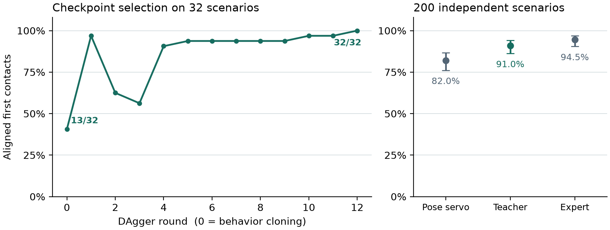

# Training the privileged teacher

The teacher maps our arm state and the partner palm's delayed ground-truth pose and velocity to seven joint velocities. Its information about the partner has the same latency as the latest depth frame. During training, a differential inverse-kinematics expert supplies target actions. The expert uses a memoryless rule to close the palm when lateral alignment and orientation are within tolerance. The learned teacher supplies labels for the depth student's actions and serves as a privileged-information reference during evaluation.

The actor has two 256-unit tanh hidden layers. We initialized it with 27 epochs of behavior cloning on 1,600 expert episodes. At each of 12 DAgger rounds, the current policy visited 24,000 states, the expert labeled those states, and eight epochs of regression fitted the accumulated labels. The run used seed 0, ten rollout workers and zero PPO update steps. The 3,072 nominal scenarios came from the training random stream. Training and validation scenarios use distinct random streams, including when their numerical seeds coincide.

## What changed during training

On 32 nominal selection scenarios, the behavior-cloned policy achieved 13 aligned touches. One DAgger round brought it to 31, but the next two rounds yielded 20 and 18. The selected final round achieved 32/32 at a mean loss of 1.02. Checkpoint performance fluctuated as the labels expanded to states visited by the learner. The selection-set maximum is optimistic, so we froze round 12 before evaluating it on a second set of scenarios. [All 13 checkpoints](selection.json) · [Per-trial selection records](selection_trials.jsonl.gz)

On the 200 separate validation scenarios, the teacher made **182 aligned touches (91.0%, 95% Wilson interval 86.2–94.2%)**. The classical servo receiving ground-truth pose at camera timing made 164 (82.0%), and the expert who labeled the teacher made 189 (94.5%). On discordant pairs, 26 seeds succeeded only for the teacher and eight only for the pose servo (two-sided exact McNemar p = 0.00294). The teacher had 11 collisions, four timeouts and three misaligned touches. Each comparison used identical scenario covariates within a seed, and all 600 trials finished. [Full independent validation records](bar_trials.jsonl.gz) · [Paired tests](bar_paired.csv) · [Pairing audit](pairing_audit.json)

**Figure 1** shows how repeated on-policy labeling changed performance on the selection set and how the frozen model compared with its two references on the independent set. The right-hand intervals are 95% Wilson intervals. The pose servo estimates velocity from the sequence of poses. The expert and teacher also receive the simulator's delayed partner velocity. These validation measurements describe the privileged teacher used for distillation. The final study evaluates the student using depth and its own arm state on separate nominal and wide scenarios. [Vector figure](training.pdf) · [Data and plotting code](plot_training.py)



## Reproduce the fit

From a checkout with the project dependencies installed, these commands restore the exact scenario bank and fit all 13 checkpoints. The benchmark development run used Drake 1.58.0, PyTorch 2.8.0+cpu, Stable-Baselines3 2.9.2 and Python 3.12.12. The archive preserves the sampled robot trajectories and avoids repeating their inverse-kinematics solves.

```bash
mkdir -p banks/phase2infra
gzip -dc docs/perception_results/training/teacher/nominal_bank.pkl.gz > banks/phase2infra/nominal.pkl
sha256sum banks/phase2infra/nominal.pkl
export OPENBLAS_NUM_THREADS=1 MKL_NUM_THREADS=2 OMP_NUM_THREADS=2
.venv/bin/python scripts/train_teacher.py \
  --bank banks/phase2infra/nominal.pkl --name teacher_reproduction \
  --seed 0 --steps 0 --workers 10 --warm-start 1600 --warm-epochs 27 \
  --dagger-rounds 12 --dagger-steps 24000 --dagger-epochs 8 --val-seeds 32
```

The expected uncompressed SHA-256 is `4e452c74cc02a4cdb3e2ff63e6a2802169b5198ed260b0c801e14b5d6d18ca0d`. To resample independently, run the following command. The archived run parallelized the same training seeds 0–3071 across eight equal shards, with no failed seeds. The bank includes machine and elapsed-time metadata, so a new file gets a different checksum. Individual trajectories can also depend on the inverse-kinematics solver and machine. [Bank and shard provenance](bank_manifest.json)

```bash
.venv/bin/python scripts/build_bank.py --preset nominal --first-seed 0 \
  --n 3072 --workers 8 --out banks/regenerated_nominal.pkl
```

## Checkpoint selection and independent validation

Each of the 13 checkpoints was scored on the same 32 nominal validation scenarios, seeds 0–31. We selected the checkpoint with the most aligned touches and used the smaller mean benchmark loss to break a tie. The following commands apply that rule to a reproduction run and evaluate the frozen choice on the separate nominal validation seeds 100–299 against the memoryless servo expert and the classical servo given ground-truth pose at camera timing. `check_teacher.py` writes the raw trials and analysis tables under `results/teacher_bar/`.

```bash
run=results/teacher/teacher_reproduction
checkpoint=$(.venv/bin/python - "$run" <<'PY'
from pathlib import Path
import sys
import pandas as pd
from dap.scoring import dap_loss

run = Path(sys.argv[1])
trials = pd.read_json(run / "val.jsonl", lines=True)
trials["loss"] = dap_loss(trials)
groups = trials.groupby("checkpoint", sort=False)
summary = groups.agg(successes=("success", "sum"), loss=("loss", "mean"))
winner = summary.sort_values(["successes", "loss"], ascending=[False, True]).index[0]
print(run / f"ckpt_{winner}")
PY
)
export OPENBLAS_NUM_THREADS=1 MKL_NUM_THREADS=1 OMP_NUM_THREADS=1
.venv/bin/python scripts/check_teacher.py "$checkpoint" --workers 12
```

To use the published teacher, call `dap.teacher.load_teacher("models/policies/teacher")` from the repository root. The loader reads its network and the corresponding observation-normalization statistics. The archive records training configuration, expert warm-start statistics, aggregated-label errors by round, all model-selection measurements and an independent validation comparison with the pose servo and expert. [Training configuration](config.json) · [Warm start](warm_start.json) · [DAgger rounds](dagger.jsonl) · [Checksums and software versions](reproduction.json)

Regenerate the figure with `.venv/bin/python docs/perception_results/training/teacher/plot_training.py`.
